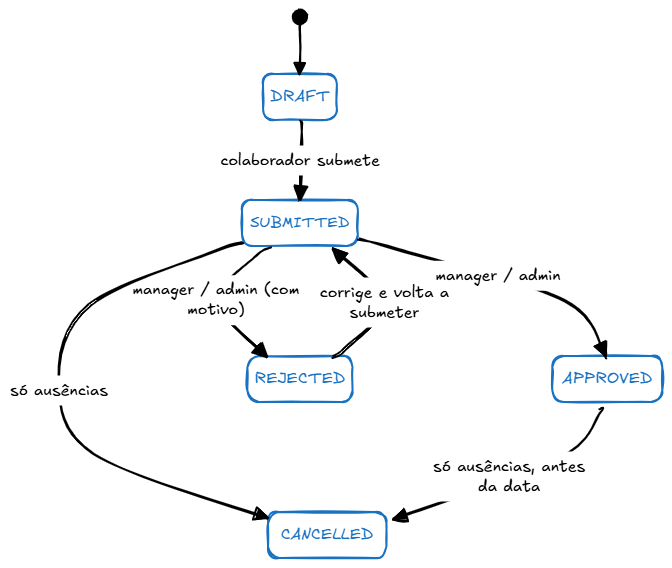

# TimeGrid

## A ideia

Uma das empresas onde trabalhei tinha registo de entradas e saídas num terminal de picar o ponto. Cada colaborador também tinha acesso a uma área reservada na intranet para marcação de férias, depois sujeito a aprovação pela chefia do departamento.

Nunca conheci o software que estava por detrás disso, mas isso fez-me pensar como seria um software para organizar registos dos colaboradores para empresas de maior dimensão. Pensei em algumas ideias a implementar, com potencial de aplicar vários conceitos de programação e regras de negócio, e assim demonstrar as minhas capacidades como programador fullstack.

## O projeto

A minha proposta é desenvolver um software de gestão de presenças e ausências com registo de banco de horas, pedidos de férias, perfis de acesso, notificações, etc. O desafio é desenvolver o projeto sem usar agentes de IA diretamente.

## Funcionalidades

- **Multi-tenancy**: várias empresas numa só BD, mas cada uma só vê os seus dados. 
- **Registo de horas**: registo por dia de cada funcionário das horas trabalhadas. Validar sobreposições.
- **Ausências**: férias, doença, formação e assuntos pessoais, com contagem de dias úteis e cancelamento.
- **Banco de horas**: calcular a partir do saldo de cada dia, descontando fins de semana, feriados e ausências aprovadas.
- **Feriados**: os nacionais portugueses são calculados automaticamente (incluindo dias móveis como a Páscoa); cada empresa pode acrescentar os seus.
- **Segurança**: Spring Security com JWT. CORS.
- **Perfis (Admin, Gestor, Colaborador)**, com permissões RBAC.
- **Notificações**: notificar utilizares por WebSocket (realtime no frontend) e por email.
- **Logs**: auditar eventos como: logins (com sucesso e falhados), alterações de registos, mudanças de estado, etc.
- **Exportações**: CSV, Excel e PDF.
- **i18n**: mensagens de erro a inglês e português, conforme o `Accept-Language`.

## Tecnologias

- Java 21
- Spring Boot 4
- Spring Security 6 com JWT
- Flyway
- Gradle
- JUnit e Mockito
- PostgreSQL
- React 19
- TanStack Query
- TypeScript
- Vite
- Docker
- GitHub Actions (build, testes, lint)
- WebSocket/STOMP e STOMP.js
- Spring Mail com Thymeleaf
- springdoc-openapi
- PDFBox

## Como executar


Pre-requisitos: Java21, Node LTS, Docker

```sh
# 1. Subir a base de dados no docker:
docker compose up -d db mailpit

# 2. Backend em ambiente dev
./gradlew bootRun --args='--spring.profiles.active=dev'

# 3. Frontend, noutro terminal
cd frontend
npm install
npm run dev     # http://localhost:5173
```

A base de dados arranca com dados de demonstração: 3 organizações, utilizadores e departamentos.

| Perfil | Utilizador | Password |
|---|---|---|
| Admin | `goncalo.esteves` | `timegrid2026` |
| Manager | `tiago.figueiredo` | `gestor123` |
| Employee | `ines.moura` | `equipa2026` |

## Testes


```bash
# 1. testes backend:
./gradlew test

# 2. frontend: Vitest
cd frontend
npm test
```

## Especificações, ADRs e Outras Considerações

### 25 Junho

- Usar Gradle em vez de Maven: é uma ferramenta de build recente, rápida e flexível. Usar ficheiros groovy para a configuração. 
- Criar tabelas do PostgreSQL: organizations, users, roles, time_entries, absents, log_events.
- Usar UUID para chaves das tabelas: melhor segurança numa aplicação multi-tenant. Custo: mais espaço e índices mais lentos.
- Usar os campos `created_at` e `updated_at` do tipo timestamp nas tabelas relevantes.
- Usar soft-delete em vez de hard-delete, tendo o campo `deleted_at` a `NULL` para registos ativos. Custo: todas as queries JPA devem ficar com o filtro AndDeletedAtIsNull.
- Usar Flyway para gerir o schema da base de dados. Configurar o Hibernate com `ddl-auto: validate`
- Criar dados de demonstração para ambiente dev.
- Ficheiros java organizados por camada. A alternativa seria organizar por funcionalidade, mas espera-se que o projeto não cresça demasiado em número de classes.
- Enums guardados como texto: abordagem diferente do que fiz em projetos grandes que desenvolvi, mas aceitável para a dimensão deste projeto; previne os problemas de usar campos de estado numéricos quando alteramos a lista dos enums.
- Usar `record` para os DTOs.
- Usar Lombock para código boilerplate.

### 27 Junho

- Campo timezone nas empresas (tabela organizations).
- Departamentos das empresas (tabela teams): Para separar quem aprova registos de outros colaboradores.
- Users e Roles com 3 tipos de perfis: Administrador, Gestor e Colaborador.
- Implementar permissões RBAC que definem o que cada perfil pode fazer
- Utilizadores com role `EMPLOYEE` não têm permissões explicitas na tabela permissions, nem precisam: as ações que conseguem ver são as que não requerem permissões.
- Estender de `BaseEntity` para entidades com id e datas automáticas

### 29 Junho

- Erro 404 (e não 403) para recursos de outra organização: desta forma não revela a existência de ids de outras organizações.
- Usar `@Transactional` nos serviços para garantir operações atómicas: se algo falhar a meio, faz rollback e tudo o que foi feito é desfeito.
- Usar `@Transactional(readOnly = true)` em operações de consulta, para melhor eficiência.
- As entities dento de `@Transactional` não precisa de `save()`: fica gerido pelo Hibernate.
- Usar a configuração `open-in-view: false` para fechar sessões JPA e evitar problemas de serialização JSON em entidades com relações LAZY.
- Usar JPQL em algumas consultas mais complexas nos repository.
- Usar SQL nativo para queries com funções do PostgreSQL ou condições ON nos LEFT JOIN.
- Usar `@EntityGraph` para trazer relações LAZY na mesma consulta com join, e evitar o problema N+1.

### 01 Julho

- Implementar JWT (JSON Web Token) com 2 tokens: acesso e refresh. Detalhes de implementação JWT: https://www.bezkoder.com/spring-boot-refresh-token-jwt/ e https://medium.com/@vishipatil/refresh-tokens-jwt-expiry-the-complete-guide-with-spring-boot-and-react-749674551005
- Access token é de vida curta: 15 minutos.
- Refresh token tem vida mais longa. Serve para pedir um access token novo. É guardado na bd e pode ser revogado.
- Como o servidor é stateless (não guarda sessão) não é possível desligar um token JWT de acesso. Se o token de acesso fosse válido por vários dias, se fosse roubado dava acesso durante todo esse tempo. Por esse motivo existe o refresh token para mitigar estragos como esse.
- Refresh token tem rotação: cada refresh só usa uma vez, gera um novo, e revoga o anterior.
- Logout revoga o refresh token, mas o access token continua válido (no máximo 15 minutos). Este é o preço de um servidor stateless e do funcionamento do JWT.
- CSRF desligado: Como estamos a usar JWT em que os tokens vem nos header dos pedidos, o browser não precisa enviar cookies, logo não se aplica este tipo de ataques.
- Tratar exceções por falta de autenticação (401) e por falta de permissão (403) nos filtros do spring security e não no `@RestControllerAdvice`. Para os dois casos escrevem no `ProblemDetail` à mão para uniformizar o formato dos erros. Referência: https://devlach.com/blog/java/spring-security-custom-authentication-failure

### 05 Julho (Frontend)

- Usar proxy do Vite: reencaminhar pedidos ao backend `/api` no 8080. Frontend responde na porta 5173, sem problemas de CORS em desenvolvimento.
- Centralizar todos os pedidos ao backend numa função apiFetch(), para gestão transparente dos tokens, erros, etc
- Em cada pedido incluir o token de acesso JWT nos headers.
- Em caso de token expirado recebe erro 401; faz um pedido de um novo token no `refreshAccessToken()`. Se resultado ok e faz novo pedido inicial novamente, só 1 retry no máximo. Se resultado do token falha, limpa tokens, dados de user, e redireciona para o /login.
- Um problema comum em aplicações React com tokens JWT é que podem ocorrer pedidos em simultâneo quando o token expira. Neste caso, múltiplas chamadas `refreshAccessToken` seria um problema, porque cada token recebido invalida os anteriores. A solução para isso é usar o padrão Singleton Promise na na função `refreshAccessToken`: garante que só há um refreshPromise ativo, e os restantes pedidos esperam por ele. Mais informação: https://paths.grasp.study/modules/d5dc492c-bd15-408e-85f8-3c946cab85d3/lessons/79dfc6c3-5d88-42a1-88bb-d0505ab364e8 e também https://medium.com/@navinduamerasinghe/react-jwt-authentication-with-axios-handling-access-and-refresh-tokens-6882231af75c
- Guardar o access token JWT numa variável em memória. Não sobrevive a um refresh do browser, mas é aceitável para um token de vida curta, e mais seguro do que guardar no localStorage ou cookie.
- Guardar refresh token no localStorage.
- Usar TanStack Query para gestão de estado dos pedidos, cache, erros, etc. Referências de implementação em https://medium.com/@ignatovich.dm/tanstack-query-a-powerful-tool-for-data-management-in-react-0c5ae6ef037c
- Criar hooks das páginas, com a mesma estrutura: `const { data, isLoading, isError, error } = useAlgumaCoisa(...);`
- Confirmações: usar window.confirm
- Usar tipos TypeScript que refletem os DTOs
- Usar CSS Modules com variáveis globais no :root.
- Usar datas locais em vez de toISOString() que mostra datas no UCT.
- Usar processamento de erros unificado com ProblemDetails usando o RFC 9457. Erros vêm como `application/problem+json`.
- QueryClientProvider / `retry: false`: sem isto, o TanStack Query repete 3 vezes cada pedido falhado o que seria um problema em erros como 403 ou 422.

### 08 Julho

- Criar tabela `time_entries` com registo de horas, cada registo o dia especifico e o intervalo correspondente com hora de entrada e hora de saída. Incluir um campo `break_minutes` para pausa dentro do intervalo do registo. Pode haver mais de um registo por dia, mas não sobrepor horas.
- Criar tabela `absents_requests` para registo de ausências. Guardar intervalo de dadas (dia do início e dia do fim).
- Ambas as entidades devem aplicar múltiplas regras de negócio indicadas abaixo.
- Não pode haver sobreposição de intervalos nos registos (verificar horas e datas) para a mesma pessoa, excepto para registos apagados.
- Registos de entrada / ausências podem ter multiplos estados. Minha proposta:

- Estados de ambos os registos semelhantes, mas registo de ausências terá ainda o estado adicional `CANCELED`.
- Nenhum colaborador pode aprovar nem rejeitar os próprios pedidos.
- Haverá transições de estado que só serão permitidas para determinados perfis de utilizador (role).
- Editar ou apagar registos só é possível em `DRAFT` ou `REJECTED`
- Editar um registo `REJECTED` volta a pô-lo em `DRAFT` e limpa o motivo da rejeição
- Estado `APPROVED` é final.
- Pensar em criar uma máquina de estados para desacoplar a complexidade nos services para transição de estados.
- Registo de ausências deve calcular número de dias úteis: nº de dias entre o inicio e o fim (inclusive) que são seguda-sexta e não são feriado (nacional ou da organização). Será depois usado no cálculo do banco de horas a implementar mais tarde.

### 10 Julho

- Preferir proteções por permissão nos métodos de controllers com `@PreAuthorize` e não por role. Desta forma, as regras do que cada perfil pode fazer fica numa tabela da bd, em vez de espalhado no código. Dar uma permissão nova é uma migração, sem mexer no java.
- Tradução i18n das mensagens de erro, com deteção do Locale do utilizador conforme o `Accept-Language`. Usar `Locale.ENGLISH` como fallback.
- Centralizar regras de negócio repetidas numa classe comum `ApprovalPolicy`: princípio DRY.

### 12 Julho

- Implementar máquina de estados dos registos/ausências. Define as regras de quem pode mudar os estados. Usar uma tabela na bd `workflow_transitions` configurável com as regras de quem pode mudar os estados. Regras de transição do estado são definidas por organização ou por tipo de entidade, e podem mudar com o tempo. Com esta implementação evita-se escrever ifs no código.
- `WorkflowService` não consegue incluir todas as regras de transição de estado. Checks como "é o próprio dono" ou "está num estado editável" não são transições.
- Usar `@Cacheable` em consultas `workflow_transitions` para cache simples em memória por conter definições que quase nunca mudam. Guarda cache em cada instância Tomcat, mas já evita dezenas de consultas à bd para um uso típico. Invalidar cache ao modificar definições na tabela.
- Guardar histórico de alterações de estado numa tabela `status_changes`. Para uma aplicação deste tipo é importante ter um histórico com a linha do tempo de cada registo/ausência com informação relevante como: qual os estados que transitou, quem alterou e quando.
- implementar log de eventos na tabela `log_events`. Ao contrário do histórico, a ideia é registar operações não críticas na aplicação. Usar `ApplicationEventPublisher` e `@TransactionalEventListener` do spring para registar eventos. A ideia é que o service não precisa saber quais os listners estão ativos, e assim acrescentar listners novos é transparente. Usar transação própria com `REQUIRES_NEW` por não ser uma operação crítica. É uma versão mais simples do que implementei noutros projetos.
- Endpoint `GET /api/log-events` com paginação e filtros opcionais
- Usar `getRemoteAddr()` e não `X-Forwarded-For` porque pode ser forjado. Em produção `server.forward-headers-strategy: native` faz com que o Tomcat confie nesse cabeçalho só quando vem do proxy.

### 15 Julho (Notificações)

- Ha uns anos atrás criei um plugin para aplicações PHP com Yii2 a fim de gerir notificações centralizadas https://github.com/webzop/yii2-notifications. A proposta aqui é criar o mesmo conceito: Eventos geram notificações, que por sua vez são enviadas para múltiplos canais configurados usando o padrão strategy.
- O caso de uso é notificar utilizadores especificos para aprovar registos de horas/ausências quando são criados. Usar o mecanismo de event listner do spring já usado anteriormente. O listner deve selecionar quem será notificado, guardar notificações numa tabela `notifications` da bd, e por fiz faz notify para que os canais registados processem as notificações.
- Não faz sentido que os managers de uma organização grande recebam notificações (ex: para aprovar registos) de outros departamentos. Tentar usar managers do mesmo departamento para separação de notificações, e fallback com outros manages. Uso de departamentos é opcional.
- O envio de notificações em `NotificationService::deliver` deve captar qualquer exceção disparada pelo channel com `try/catch`. Um email que falhou não deve parar todo o loop de envio. O mesmo principio foi implamentado no yii2-notifications em https://github.com/webzop/yii2-notifications/blob/master/Module.php#L35

### 16 Julho (email e websocket)

- Implementar channel de email, usando Mailpit no docker para simular uma conta de email. HTML dos emails gerados com Thymeleaf. O envio de emails é assícrono porque conexões SMTP são lentas e poderiam deixar utilizadores em espera.
- Como o envio de emails usa `@Async`, o método `deliver` corre noutra thread e assim exçexões não são capturadas na thread principal. Por essa razão usa o log do `Slf4j` que regista o erro do envio, pois sem isso erros perdiam-se em silêncio.
- Implementar channel para WebSocket com o protocolo STOMP para notificações realtime no browser. As ligações WebSocket são servidas no `/ws` e são protegidas no `StompAuthInterceptor.preSend` com validação de token JWT num cabeçalho nativo do frame `CONNECT`.

### 17 Julho

- Implementar APIs para exportar relatórios. Usar o mecanismo de injeção de dependência do spring com `List<Interface>` para registar todas as implementações de formatos de exportação. Neste caso acrescentar um novo formato basta criar um componente que faz `implements ReportWriter` que o `ExportService` o detecta automaticamente.
- Implementar 3 formatos de exportação: CSV, Excel, PDF.
- Implementar cálculo de feriados: será necessário para contagem de dias úteis / banco de horas. Há dois tipos: 
- Feriados nacionais: calculados em código para qualquer ano. Calcular apenas feriados portugueses. Usar algoritmo de Gauss/Meeus para calcular o domingo de páscoa.
- Feriados da organização: são guardados numa tabela da bd `holydays`. Exemplo: O Carnaval (que é facultativo) e feriados municipais.

### 20 Julho

- Banco de horas: o calculo é feito a partir soma de horas trabalhadas menos as horas esperadas para cada dia. Esperado é igual ao valor de `user.dailyWorkMinutes` se for um dia útil (excepto fim-de-semana, feriado, ausência). Horas trabalhadas é a soma dos registos de horas aprovados (não apagados) desse dia, sem os minutos de pausa.

### 22 Julho (Páginas)

- cada registo de hora/ausência traz a lista de estados para onde o utilizador o pode transitar em `.allowedActions` calculados no servidor. O frontend usa isto para decidir que botões aparecem, em vez de duplicar as regras/logica do workflow.
- Páginas do frontend por funcionalidade: registos com vista semanal, ausências com formulário, aprovações com separadores dos pendentes, dashboard com o banco de horas, feriados, notificações e exportações.
- O sino das notificações mostra o contador das não lidas e recebe-as em tempo real por WebSocket/STOMP.

### 27 Julho

- Componentes partilhados no frontend (StatusBadge, EmptyState e TableRowActions), para as tabelas de registos e ausências não repetirem markup.
- Páginas de utilizadores, departamentos e organização, com edição de roles e das horas diárias por utilizador.

### 29 Julho

- Docker: Dockerfile do backend (jar + JRE) e do frontend (build do Vite servido por nginx).
- Docker compose com backend, frontend, postgres e mailpit.
- Swagger desligado em produção; OpenAPI documentado com springdoc.

### 31 Julho

- O projeto cresceu mais do que esperei inicialmente. Faria sentido reorganizar as pastas por domínio em vez de por camadas.
- CI do GitHub Actions a correr o build do Gradle e os testes e lint do frontend.
